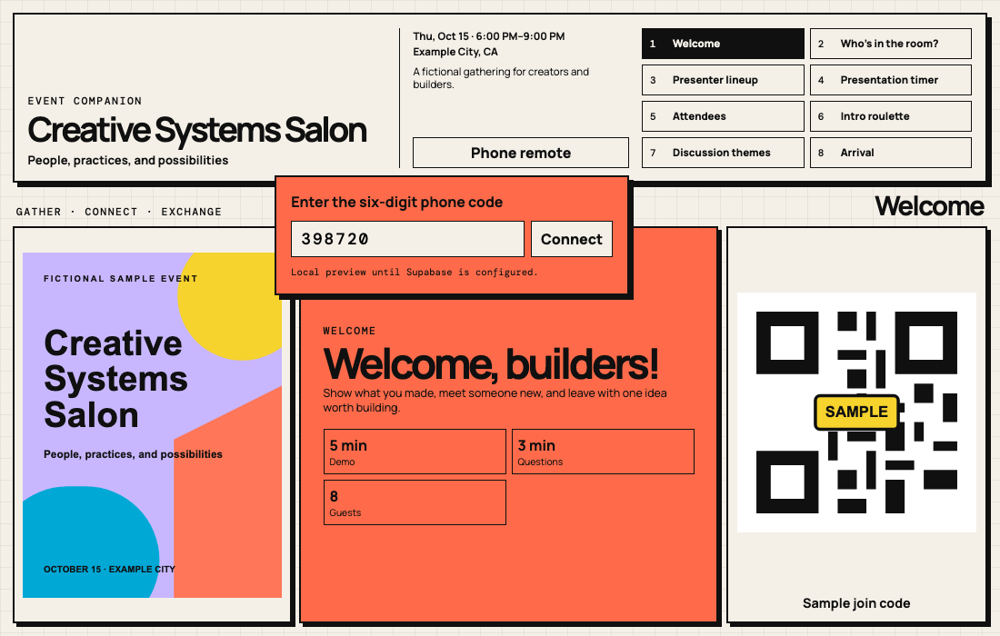
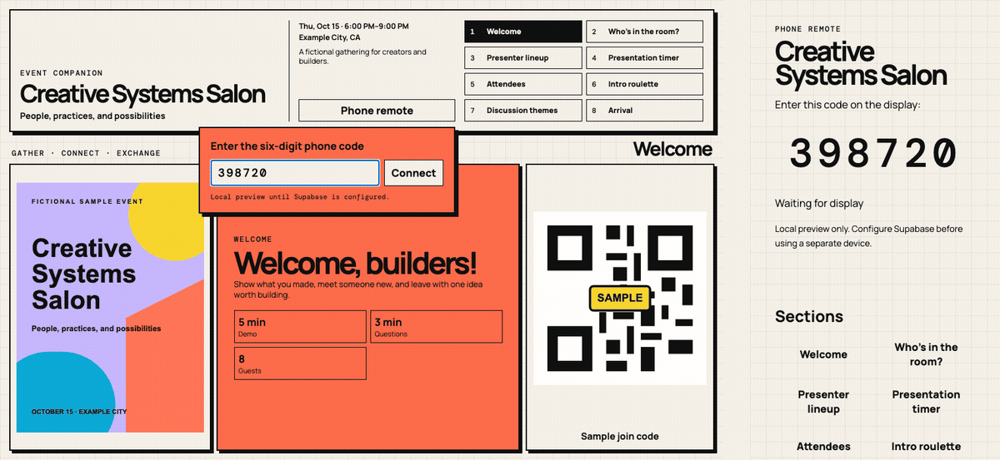

# Build Event Companion

A reusable Codex skill for turning event registrations into responsive, modular event websites. It accepts Luma registrations, CSV/TSV files, Excel workbooks, Google Sheets exports, JSON, or pasted text, then guides organizers through selecting appropriate modules.

> Status: public beta. The skill has automated unit, build, projector-layout, privacy, and paired-remote tests.

## Fictional sample

The repository includes a fictional Creative Systems Salon event so the full workflow can be explored without using personal data or external accounts.





## What it builds

- Welcome screen with poster, event details, statistics, and QR code
- Room analysis with normalized roles, counts, percentages, and attendee drill-down
- Presenter lineup with fixed hosts and repeatable randomization
- Multi-stage presentation timer with automatic transitions and a persistent final alarm
- Paired phone remote for navigation, lineup randomization, and timer control
- Optional attendee directory, intro roulette, discussion themes, agenda, arrival information, and custom modules
- Responsive layouts for projector screens, desktops, and phones

The guided kickoff helps first-time users choose an information source, a module preset, and whether to include a phone remote. Every generated event remains independently configurable.

## Requirements

- Codex with local skill support
- Node.js `20.19+` or `22.12+`
- npm
- Chromium only when running the optional visual and remote browser tests

## Install

Download the `build-event-companion-vX.Y.Z.zip` asset from the repository's [latest Release](../../releases/latest), unzip it, and place the resulting folder at:

```text
~/.codex/skills/build-event-companion/
```

Alternatively, clone this repository and copy its `build-event-companion/` folder into `~/.codex/skills/`. Restart Codex if the skill does not appear immediately, then ask:

```text
Use $build-event-companion to create an event website from my registration data.
```

The installable package is in [`build-event-companion/`](build-event-companion/). Its [`SKILL.md`](build-event-companion/SKILL.md) is the canonical agent-facing workflow. [Official OpenAI documentation](https://developers.openai.com/api/reference/python/resources/skills/methods/create) also supports uploading a skill directory or ZIP bundle through the Skills API.

## Update or uninstall

To update, replace only the existing `~/.codex/skills/build-event-companion/` folder with the folder from a newer release. Preserve event projects elsewhere; generated events should never be stored inside the installed skill folder.

To uninstall, remove only `~/.codex/skills/build-event-companion/`, then restart Codex.

## Typical workflow

1. Provide a registration source.
2. Choose a recommended module kit or a custom combination.
3. Review normalized attendee data and registration-question mappings.
4. Preview the generated site and test the phone remote in two browser tabs when enabled.
5. Publish only after reviewing the public fields and approving the preview.

## Try the fictional sample

```bash
cd build-event-companion
npm ci
npm test
npm run validate:sample
npm run build:sample
cd .tmp/sample-site
npm install
npx playwright install chromium
npm run audit:layout
npm run test:remote
npm run dev
```

Open the local URL printed by Vite. The sample remote uses `BroadcastChannel`, so it works in two tabs without Supabase, API keys, or any external account.

## Privacy and event isolation

- Registration exports and `*.private.json` files must not be committed.
- Generated public sites exclude emails, raw registration answers, and source records.
- Attendee-authored overrides remain separate from imports.
- Create separate deployment and persistence resources for each event unless the organizer explicitly chooses otherwise.
- Never publish verbatim registration answers without organizer review.
- Release automation scans tracked files for common secrets, local filesystem paths, non-example email addresses, and hosted-project identifiers.

The repository contains fictional sample data only. It includes no live database URL, API key, deployment identifier, custom domain, or real attendee record.

## Phone remote and persistence

The remote works locally in two tabs through `BroadcastChannel`. Cross-device control can use a separately configured Supabase Realtime broadcast channel through `VITE_SUPABASE_URL` and `VITE_SUPABASE_PUBLISHABLE_KEY`.

The static event site remains viewable if the optional relay is unavailable. A production organizer is responsible for the availability, access policy, and lifecycle of any relay they configure.

## Limitations

- Luma access depends on the organizer's available export or authenticated browser session.
- The default six-digit remote channel is intended for ordinary live-event facilitation, not sensitive control surfaces.
- High-risk events should use authenticated private channels and Realtime Authorization.
- Profile editing requires server-side identity verification and durable storage; client-only email checks are not sufficient.

## Contributing and security

See [CONTRIBUTING.md](CONTRIBUTING.md) for development instructions and [SECURITY.md](SECURITY.md) for private vulnerability reporting. Please follow the [Code of Conduct](CODE_OF_CONDUCT.md).

## License

[MIT](LICENSE)
